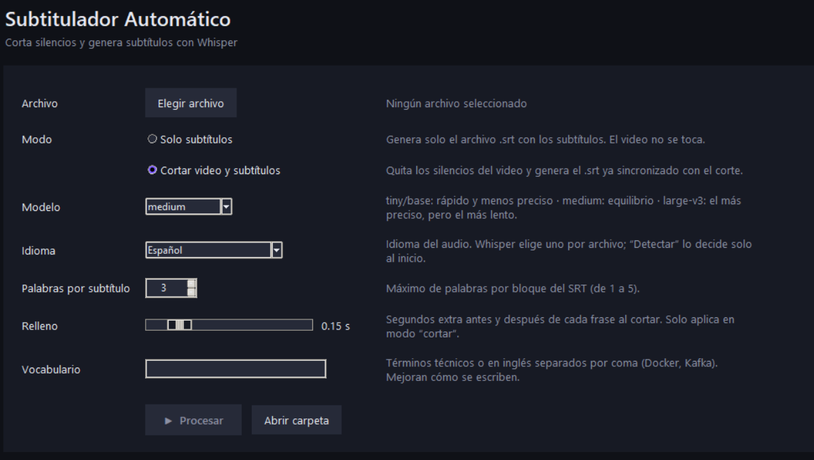

# Cortador y Subtitulador Automático

Corta los silencios de un video o audio y genera subtítulos `.srt` sincronizados con el corte, usando [Whisper](https://github.com/openai/whisper) (vía [faster-whisper](https://github.com/SYSTRAN/faster-whisper)).




## Características

- Quita los silencios y une solo las partes con voz.
- Genera subtítulos `.srt` con los tiempos ya recalculados para el video cortado.
- Modo **solo subtítulos** si no quieres tocar el video.
- Transcripción con GPU NVIDIA (CUDA) y respaldo automático a CPU.
- Español, inglés o detección automática de idioma.
- Campo de **vocabulario** para mejorar la escritura de términos técnicos o en inglés.
- Número de palabras por subtítulo ajustable (de 1 a 5).
- Formatos: `mp4`, `mov`, `avi`, `mkv`, `mp3`, `wav`, `m4a`, `flac`, `ogg`.

## Descargar

### Opción 1: ejecutable para Windows (la más fácil)

1. Ve a la sección [**Releases**](https://github.com/TheSe3d/cortador-subtitulador/releases) y descarga `Subtitulador-v0.1.0-windows.zip`.
2. Descomprime **toda la carpeta**. No muevas solo el `.exe`, porque necesita los archivos que vienen junto a él.
3. Abre `Subtitulador.exe`.

Necesitas tener **ffmpeg** instalado (ver [Requisitos](#requisitos)).

Windows Defender o SmartScreen pueden mostrar una advertencia, porque el archivo no tiene firma digital. Si confías en la descarga, haz clic en **Más información** y luego en **Ejecutar de todas formas**.

### Opción 2: con Python

```bash
pip install "cortador-subtitulador[cuda] @ git+https://github.com/TheSe3d/cortador-subtitulador"
```

Si no tienes GPU NVIDIA, instala sin el extra `[cuda]`:

```bash
pip install "git+https://github.com/TheSe3d/cortador-subtitulador"
```

Después ejecuta:

```bash
subtitulador
```

## Requisitos

- **Windows 10 u 11** para el ejecutable. La instalación con Python también funciona en otros sistemas, pero no se ha probado.
- **ffmpeg y ffprobe** en el PATH. No se instalan con pip:
```
  winget install Gyan.FFmpeg
```
  Después abre una terminal nueva.
- **GPU NVIDIA con drivers actualizados** (opcional, pero recomendado). Sin GPU el programa funciona, pero es más lento.
- Conexión a internet la primera vez que uses un modelo, para descargarlo.

## Uso

1. Elige el archivo.
2. Elige el modo (ver tabla abajo).
3. Ajusta el modelo, el idioma, las palabras por subtítulo y, si aplica, el relleno y el vocabulario.
4. Pulsa **Procesar**.

| Opción | Qué hace |
|---|---|
| Solo subtítulos | Genera el `.srt` con los tiempos originales. El video no se modifica. |
| Cortar video y subtítulos | Quita los silencios, genera el video nuevo y el `.srt` sincronizado con él. |

Los archivos resultantes se guardan en la misma carpeta que el original, con el sufijo `_cortado`.

### Modelos

| Modelo | Velocidad | Precisión |
|---|---|---|
| `tiny`, `base` | Rápido | Menor |
| `medium` | Equilibrio | Buena (valor por defecto) |
| `large-v3` | Lento | La mejor |

La primera vez que usas un modelo se descarga desde internet.

## Cómo funciona

1. **Transcripción:** Whisper detecta la voz y devuelve el texto con el tiempo de cada palabra.
2. **Cortes:** cada frase se expande con el *relleno* para no cortar palabras, y se descartan los tramos que se solapan.
3. **Subtítulos:** las palabras se agrupan por pausas, puntuación y número máximo, y sus tiempos se convierten a la línea de tiempo del video cortado.
4. **Render:** un solo comando de ffmpeg corta, une y codifica con NVENC (o libx264 si no hay GPU compatible).

## Solución de problemas

- **`ffmpeg` no se reconoce como comando:** instálalo y revisa que la carpeta `bin` esté en el PATH. Abre una terminal nueva después de instalarlo.
- **CUDA no disponible o error de DLL:** revisa que los drivers de NVIDIA estén actualizados. El programa cambia a CPU automáticamente.
- **Falta memoria:** usa un modelo más chico (`small` o `base`).
- **El inglés sale con ortografía en español:** agrega las palabras en el campo de vocabulario o usa `large-v3`.
- **El ejecutable no abre:** asegúrate de haber descomprimido la carpeta completa.

## Roadmap

- [ ] Soporte para Linux y macOS.
- [ ] Editar el `.srt` dentro de la aplicación.
- [ ] Instalador para Windows.

## Contribuir

Las contribuciones son bienvenidas. Lee [CONTRIBUTING.md](CONTRIBUTING.md) antes de abrir un pull request.

## Licencia

[MIT](LICENSE) © Ángel Germán George Barragán

## Agradecimientos

- [OpenAI Whisper](https://github.com/openai/whisper)
- [faster-whisper](https://github.com/SYSTRAN/faster-whisper) (SYSTRAN)
- [ffmpeg](https://ffmpeg.org/) 